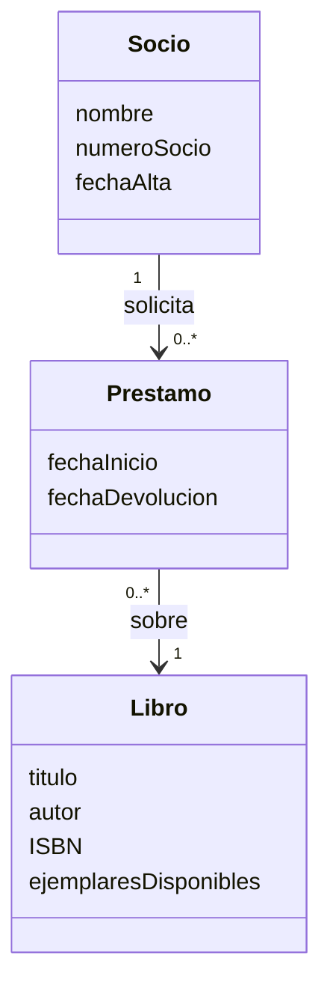
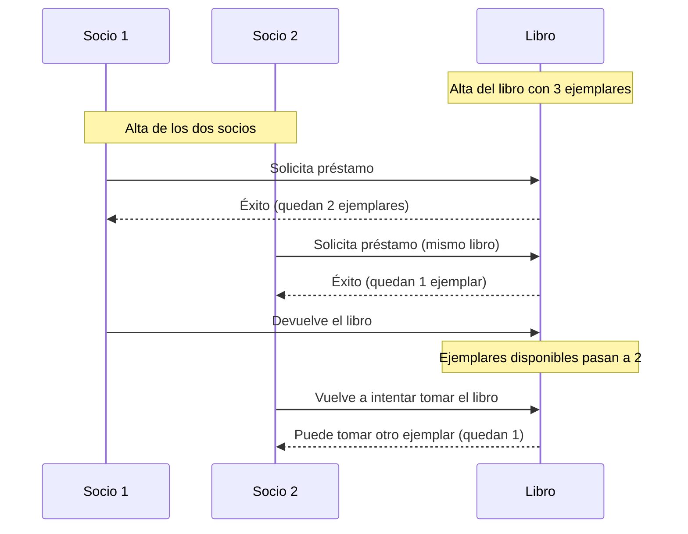

# Solución Ejercicio 1 — Diseño con Tarjetas CRC

## Enunciado

Sistema de gestión de una biblioteca que permite registrar libros y socios, gestionar préstamos y devoluciones.

---

## 1. Tarjetas CRC

### Tarjeta CRC: `Libro`

| Clase: Libro | |
|---|---|
| **Responsabilidades** | **Colaboradores** |
| Conocer su título, autor e ISBN | — |
| Conocer el número de ejemplares disponibles | — |
| Prestar un ejemplar (si hay disponibles) | `Préstamo` |
| Recibir la devolución de un ejemplar | `Préstamo` |

### Tarjeta CRC: `Socio`

| Clase: Socio | |
|---|---|
| **Responsabilidades** | **Colaboradores** |
| Conocer su nombre, número de socio y fecha de alta | — |
| Solicitar el préstamo de un libro | `Libro`, `Préstamo` |
| Devolver un libro prestado | `Préstamo` |

### Tarjeta CRC: `Préstamo`

| Clase: Préstamo | |
|---|---|
| **Responsabilidades** | **Colaboradores** |
| Conocer qué libro y qué socio están implicados | `Libro`, `Socio` |
| Conocer la fecha de inicio del préstamo | — |
| Registrar la devolución del préstamo | `Libro` |

---

## 2. Relación entre las clases

**Qué ocurre al intentar prestar un ejemplar:**

1. Se comprueba si `Libro` tiene ejemplares disponibles (> 0).
2. Si los hay: se descuenta un ejemplar disponible y se crea un `Préstamo` que relaciona ese `Libro` con el `Socio`. La operación se considera con éxito.
3. Si no los hay: no se crea el préstamo y no se modifica el número de ejemplares. La operación se considera fallida.

Al **devolver** un libro, ocurre lo contrario: el `Préstamo` se marca como finalizado y `Libro` incrementa en uno su número de ejemplares disponibles.

---

## 3. Flujo paso a paso

> Nota: como el libro tiene 3 ejemplares, ambos socios pueden tomarlo prestado sin que se agoten. El ejercicio busca que se razone sobre el control de disponibilidad, no que el segundo intento del Socio 2 falle necesariamente — dependerá de cuántos ejemplares queden en cada paso.

**Resumen de resultados:**

| Paso | Acción | ¿Éxito? | Ejemplares disponibles tras la acción |
|---|---|---|---|
| 1 | Alta del libro | — | 3 |
| 2 | Socio 1 toma prestado | Sí | 2 |
| 3 | Socio 2 toma prestado | Sí | 1 |
| 4 | Socio 1 devuelve | — | 2 |
| 5 | Socio 2 intenta tomar de nuevo | Sí (quedan ejemplares) | 1 |
