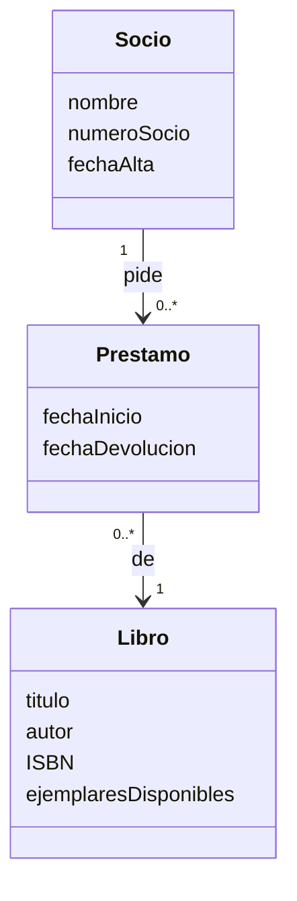
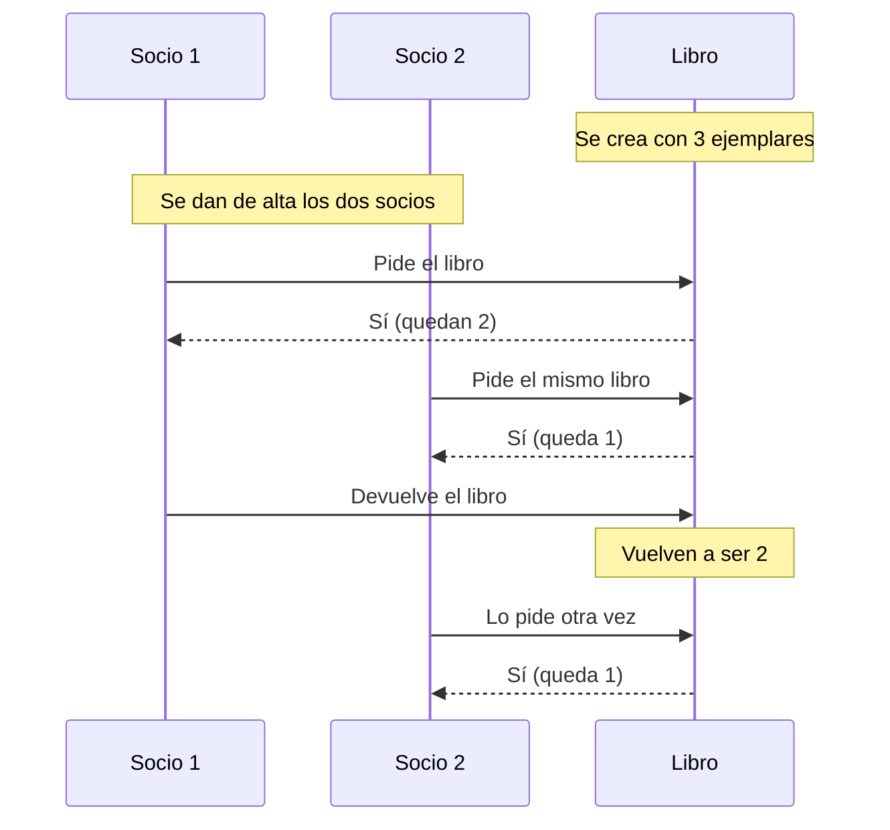

# Ejercicio 1 - Tarjetas CRC

Sistema para gestionar una biblioteca: libros, socios, préstamos y devoluciones.

## 1. Tarjetas CRC

### Tarjeta CRC: Libro

| Clase: Libro | |
|---|---|
| **Responsabilidades** | **Colaboradores** |
| Saber su título, autor e ISBN | - |
| Saber cuántos ejemplares quedan | - |
| Prestar un ejemplar si quedan | Préstamo |
| Sumar un ejemplar cuando lo devuelven | Préstamo |

### Tarjeta CRC: Socio

| Clase: Socio | |
|---|---|
| **Responsabilidades** | **Colaboradores** |
| Saber su nombre, número de socio y fecha de alta | - |
| Pedir un libro prestado | Libro, Préstamo |
| Devolver un libro | Préstamo |

### Tarjeta CRC: Préstamo

| Clase: Préstamo | |
|---|---|
| **Responsabilidades** | **Colaboradores** |
| Saber qué socio tiene qué libro | Libro, Socio |
| Saber la fecha en la que empieza | - |
| Terminar el préstamo cuando se devuelve | Libro |

## 2. Relación entre las clases

**Qué pasa cuando se quiere prestar un libro:**

1. Primero se mira si el libro tiene ejemplares disponibles (que sean más de 0).
2. Si tiene, se resta 1 a los ejemplares y se crea el préstamo con el socio y el libro. El préstamo se hace bien.
3. Si no tiene, no se hace el préstamo y los ejemplares se quedan igual.

Cuando se **devuelve** el libro es al revés: el préstamo se termina y al libro se le suma 1 ejemplar.

## 3. Flujo paso a paso

Como el libro tiene 3 ejemplares, los dos socios pueden cogerlo y nunca se acaban. El socio 2 solo no podría si no quedara ninguno.

| Paso | Qué pasa | ¿Sale bien? | Ejemplares que quedan |
|---|---|---|---|
| 1 | Alta del libro | - | 3 |
| 2 | Socio 1 pide el libro | Sí | 2 |
| 3 | Socio 2 pide el libro | Sí | 1 |
| 4 | Socio 1 lo devuelve | - | 2 |
| 5 | Socio 2 lo pide otra vez | Sí | 1 |
