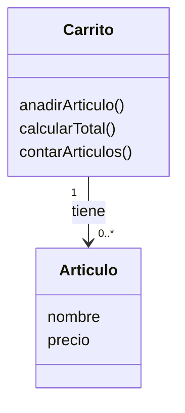
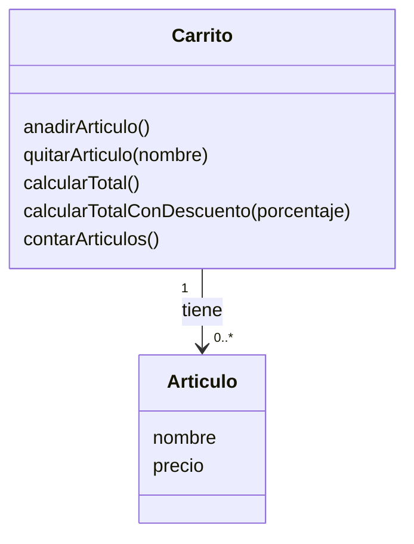
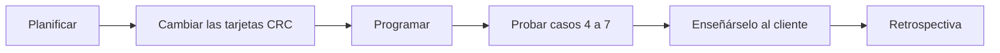

# Ejercicio 2 - Iteración ágil

Hay que diseñar un carrito de la compra en dos iteraciones, con las clases Artículo y Carrito.

## Iteración 1

### Tarjetas CRC

| Clase: Artículo | |
|---|---|
| **Responsabilidades** | **Colaboradores** |
| Saber su nombre | - |
| Saber su precio | - |

| Clase: Carrito | |
|---|---|
| **Responsabilidades** | **Colaboradores** |
| Añadir un artículo | Artículo |
| Calcular el total | Artículo |
| Saber cuántos artículos tiene | - |

### Casos de prueba

- **Caso 1:** si el carrito está vacío, el total tiene que ser 0.
- **Caso 2:** si meto un artículo de 10 € y otro de 15 €, el total tiene que ser 25 €.
- **Caso 3:** después de meter esos dos artículos, el carrito tiene que decir que tiene 2.

## Iteración 2

Después de hablar con el cliente hay que añadir dos cosas: quitar un artículo por su nombre y poder hacer un descuento en % al total.

### Tarjeta CRC actualizada

| Clase: Carrito | |
|---|---|
| **Responsabilidades** | **Colaboradores** |
| Añadir un artículo | Artículo |
| Quitar un artículo por su nombre (nuevo) | Artículo |
| Calcular el total | Artículo |
| Calcular el total con descuento (nuevo) | Artículo |
| Saber cuántos artículos tiene | - |

La clase Artículo no cambia.

### Casos de prueba nuevos

- **Caso 4:** si en el carrito hay un "Teclado" y lo quito, ya no está en el carrito y el total baja lo que costaba.
- **Caso 5:** si intento quitar un artículo que no está, el carrito se queda igual y no da error.
- **Caso 6:** si el total es 100 € y pongo un 10 % de descuento, el total tiene que ser 90 €.
- **Caso 7:** si el descuento es del 0 %, el total es el mismo.

### Pasos que hemos seguido en la iteración

