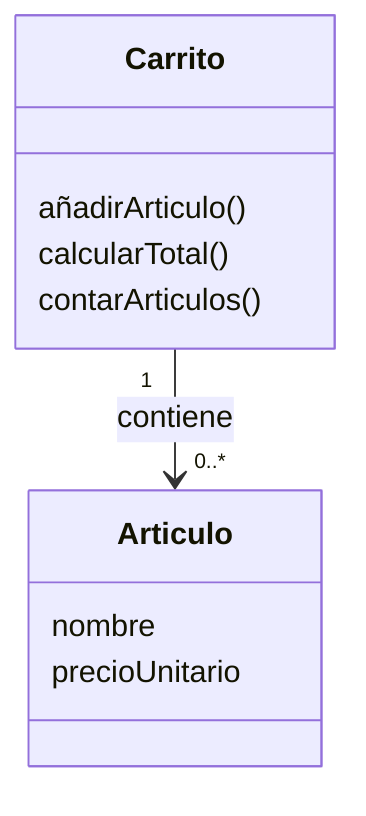
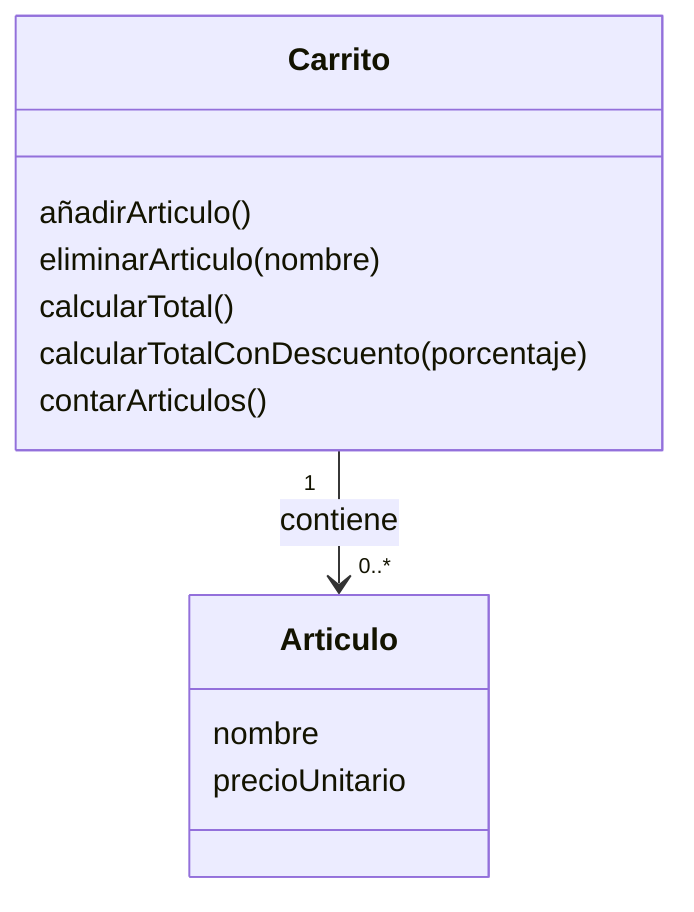
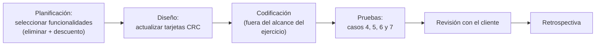

# Solución Ejercicio 2 — Simulación de iteración ágil

## Enunciado

Diseño, en dos iteraciones, de un sistema de carrito de la compra con las clases `Artículo` y `Carrito`.

---

## Iteración 1 — Funcionalidades básicas

### Tarjetas CRC

| Clase: Artículo | |
|---|---|
| **Responsabilidades** | **Colaboradores** |
| Conocer su nombre | — |
| Conocer su precio unitario | — |

| Clase: Carrito | |
|---|---|
| **Responsabilidades** | **Colaboradores** |
| Añadir un artículo | `Artículo` |
| Calcular el total | `Artículo` |
| Conocer cuántos artículos contiene | `Artículo` |

### Casos de prueba (Iteración 1)

- **Caso 1:** un carrito recién creado, sin artículos, tiene un total de 0.
- **Caso 2:** si se añaden dos artículos (por ejemplo, uno de 10 € y otro de 15 €), el total del carrito debe ser 25 €.
- **Caso 3:** tras añadir dos artículos, el carrito debe informar que contiene 2 artículos.

---

## Iteración 2 — Tras revisión con el cliente

Se añaden dos nuevas funcionalidades: eliminar un artículo por nombre y aplicar un descuento porcentual al total.

### Tarjetas CRC actualizadas

| Clase: Carrito (actualizada) | |
|---|---|
| **Responsabilidades** | **Colaboradores** |
| Añadir un artículo | `Artículo` |
| Eliminar un artículo por nombre | `Artículo` |
| Calcular el total | `Artículo` |
| Calcular el total aplicando un descuento porcentual | `Artículo` |
| Conocer cuántos artículos contiene | `Artículo` |

### Nuevos casos de prueba (Iteración 2)

- **Caso 4:** si el carrito contiene un artículo llamado "Teclado" y se elimina por ese nombre, el carrito deja de contenerlo y el total se recalcula sin su precio.
- **Caso 5:** al intentar eliminar un artículo cuyo nombre no existe en el carrito, el carrito no cambia (no debe fallar ni eliminar otro artículo por error).
- **Caso 6:** con un total de 100 € y un descuento del 10%, el total con descuento debe ser 90 €.
- **Caso 7:** un descuento del 0% debe devolver el mismo total que sin descuento.

### Flujo de la iteración

