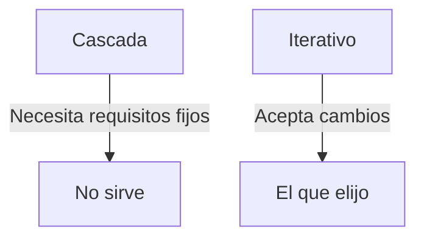
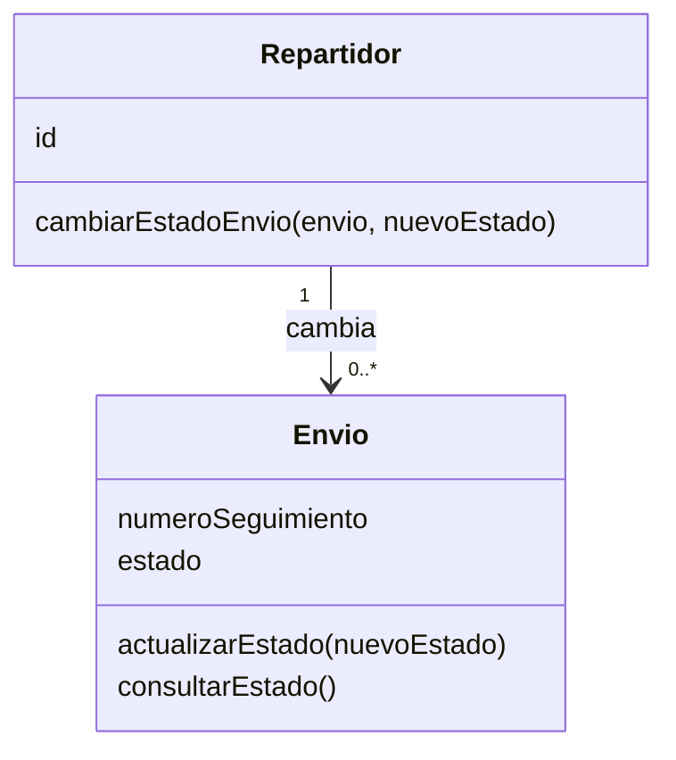
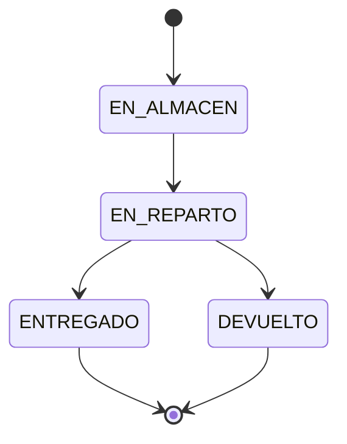

# Ejercicio 3 - Ciclo de vida

> Una empresa de logística quiere un sistema para ver el estado de sus envíos. Los clientes lo consultan online con el número de seguimiento y los repartidores lo cambian desde el móvil. Los requisitos van a ir cambiando según lo que digan los clientes piloto.

## 1. Modelo de ciclo de vida

**Yo elegiría el modelo Iterativo.**

El enunciado dice que los requisitos van a cambiar con lo que digan los clientes. En cascada los requisitos se tienen que saber desde el principio y luego es difícil cambiarlos, así que no sirve. Con el iterativo se puede hacer primero una parte (por ejemplo consultar el estado), enseñarla, y luego ir añadiendo cosas como lo del móvil según lo que digan.

## 2. Metodología

**Elegiría Ágil.**

Porque hay que ir cambiando cosas según el feedback de los clientes y Ágil está pensada para eso, con entregas cortas. Métrica v3 es la que usa la Administración Pública y tiene mucha documentación y pasos fijos, así que para una empresa de logística que tiene que cambiar rápido no es la mejor.

## 3. Tarjetas CRC

| Clase: Envío | |
|---|---|
| **Responsabilidades** | **Colaboradores** |
| Saber su número de seguimiento | - |
| Saber en qué estado está | - |
| Cambiar su estado | Repartidor |
| Decirle el estado al cliente que lo consulta | - |

| Clase: Repartidor | |
|---|---|
| **Responsabilidades** | **Colaboradores** |
| Saber su número y los envíos que tiene | Envío |
| Cambiar el estado de un envío | Envío |

## 4. Actualizar el estado

- **Qué recibe:** el estado nuevo.
- **Qué valores puede tener:** solo `"EN_ALMACÉN"`, `"EN_REPARTO"`, `"ENTREGADO"` o `"DEVUELTO"`.

**Cómo funciona:**

1. Se mira si el estado que llega es uno de esos cuatro.
2. Si lo es, se cambia el estado del envío y se devuelve `true` para decir que se ha cambiado.
3. Si no lo es (por ejemplo llega `"EN_TRANSITO"`), no se cambia nada y se devuelve `false`.

