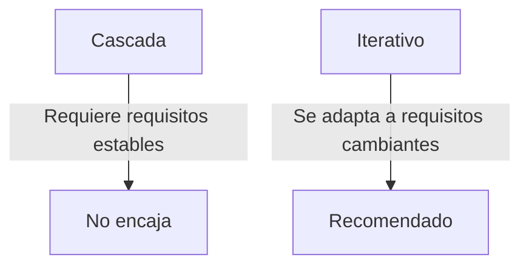
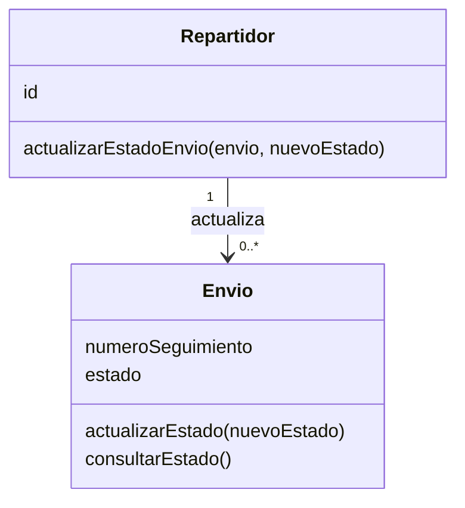
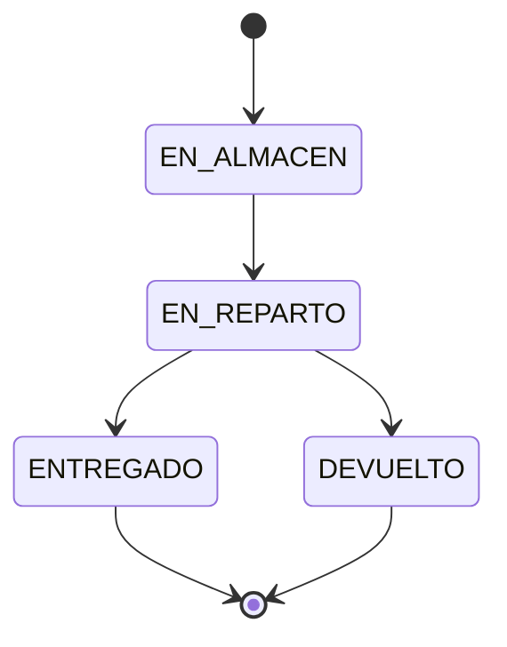

# Solución Ejercicio 3 — Ciclo de vida en la práctica

## Enunciado

> "Una empresa de logística necesita un sistema para gestionar el estado de sus envíos. Los clientes podrán consultar online el estado de su envío usando el número de seguimiento. Los repartidores podrán actualizar el estado desde su móvil. Los requisitos cambiarán a medida que el equipo de negocio reciba feedback de los clientes piloto."

---

## 1. Modelo de ciclo de vida recomendado

**Recomendación: modelo Iterativo.**

**Justificación:** el propio enunciado indica que *"los requisitos cambiarán a medida que el equipo de negocio reciba feedback"*. Esto es precisamente lo contrario de lo que necesita el modelo en Cascada, que exige requisitos estables desde el inicio. Un modelo iterativo permite entregar versiones parciales del sistema (por ejemplo, primero la consulta de estado, después la actualización desde móvil) e ir incorporando el feedback de los clientes piloto en cada ciclo.

---

## 2. Metodología recomendada

**Recomendación: metodología Ágil.**

**Justificación:** el enunciado describe un entorno con feedback continuo de clientes piloto y necesidad de adaptación constante, características propias de un entorno ágil. Métrica v3 es la metodología oficial para la Administración Pública española y está pensada para procesos más formales y documentados; no encaja con una empresa de logística que necesita iterar rápido según el feedback recibido.

---

## 3. Tarjetas CRC

| Clase: Envío | |
|---|---|
| **Responsabilidades** | **Colaboradores** |
| Conocer su número de seguimiento | — |
| Conocer su estado actual | — |
| Actualizar su estado | `Repartidor` |
| Informar del estado a un cliente que consulta | — |

| Clase: Repartidor | |
|---|---|
| **Responsabilidades** | **Colaboradores** |
| Conocer su identificador y los envíos que tiene asignados | `Envío` |
| Actualizar el estado de un envío | `Envío` |

---

## 4. Comportamiento de "actualizar el estado"

**Dato que recibe:** el nuevo estado que se quiere asignar al envío.

**Valores posibles del nuevo estado:** únicamente uno de estos cuatro: `"EN_ALMACÉN"`, `"EN_REPARTO"`, `"ENTREGADO"` o `"DEVUELTO"`.

**Comportamiento esperado:**

1. Se comprueba que el valor recibido es uno de los cuatro estados válidos.
2. Si es válido: se sustituye el estado actual del envío por el nuevo y la operación confirma que el cambio se ha aplicado (por ejemplo, devolviendo un valor afirmativo).
3. Si no es válido (por ejemplo, llega `"EN_TRANSITO"`, que no está en la lista): el estado no se modifica y la operación indica que el cambio no se ha podido aplicar.

