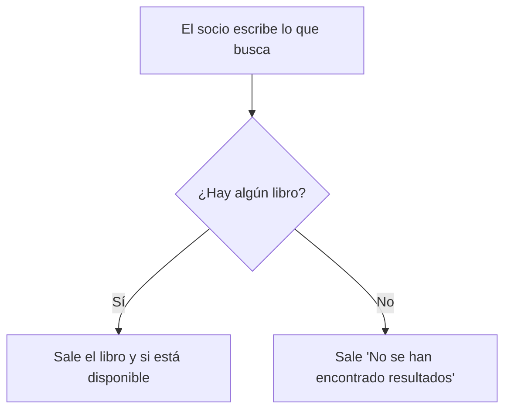

# Ejercicio 4 - Historias de usuario

## 1. Historias de usuario

**Historia 1 - Socio**

> Como **socio**, quiero **buscar un libro por el título o el autor**, para **saber si está disponible antes de ir a la biblioteca**.

**Historia 2 - Bibliotecario**

> Como **bibliotecario**, quiero **apuntar el préstamo de un libro a un socio**, para **saber qué libros están prestados y quién los tiene**.

**Historia 3 - Administrador**

> Como **administrador**, quiero **ver los libros que más se han prestado el último mes**, para **saber qué libros nuevos comprar**.

## 2. Criterios INVEST

| Criterio | Historia 1 | Historia 2 | Historia 3 |
|---|---|---|---|
| Independiente | Sí | Sí | Sí, pero hacen falta préstamos guardados |
| Negociable | Sí, el buscador puede ser simple o más completo | Sí | Sí |
| Valiosa | Sí, el socio no va a la biblioteca para nada | Sí, es lo más importante de la biblioteca | Sí, ayuda a decidir qué comprar |
| Estimable | Sí | Sí | Sí |
| Pequeña | Sí | Sí | No del todo, si se añaden filtros y exportar se hace grande |
| Testeable | Sí | Sí | No mucho, "los que más" no está claro |

La historia 3 no cumple bien lo de pequeña y testeable, así que la cambio:

> Como **administrador**, quiero **ver una lista ordenada con cuántas veces se ha prestado cada libro en los últimos 30 días**, para **saber qué libros se piden más**.

Los filtros y exportar la lista los dejaría para otra historia.

## 3. Criterios de aceptación de la Historia 1

> Como socio, quiero buscar un libro por el título o el autor, para saber si está disponible antes de ir a la biblioteca.

**Criterio 1:**

- **Dado** que en la biblioteca está el libro "El Quijote"
- **Cuando** el socio busca "quijote"
- **Entonces** sale el libro y si está disponible o no

**Criterio 2:**

- **Dado** que no hay ningún libro con lo que se busca
- **Cuando** el socio busca
- **Entonces** sale el mensaje "No se han encontrado resultados"

**Criterio 3:**

- **Dado** que el socio no ha escrito nada
- **Cuando** pulsa "Buscar"
- **Entonces** sale un aviso para que escriba algo y no se busca
