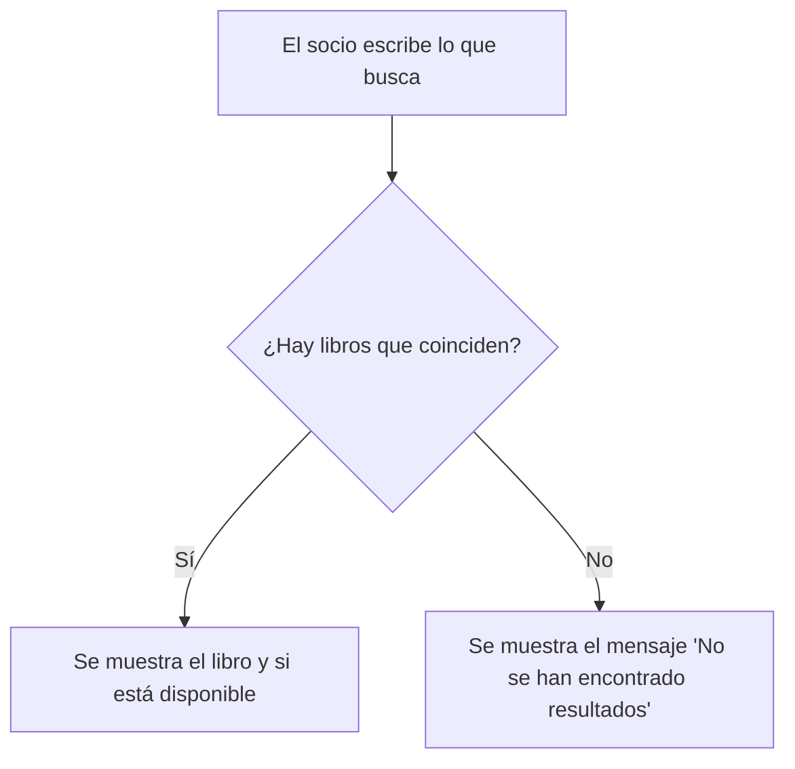

# Ejercicio 4

## 1. Historias de usuario

### Historia 1 - Socio

> Como **socio de la biblioteca**, quiero **buscar un libro por título o autor**, para **saber si está disponible antes de ir a la biblioteca**.

### Historia 2 - Bibliotecario

> Como **bibliotecario**, quiero **registrar el préstamo de un libro a un socio**, para **saber qué ejemplares están prestados y a quién**.

### Historia 3 - Administrador del sistema

> Como **administrador del sistema**, quiero **ver los libros con más préstamos del último mes**, para **decidir qué ejemplares nuevos comprar**.

---

## 2. Comprobación de los criterios INVEST

| Criterio | Historia 1 (Socio) | Historia 2 (Bibliotecario) | Historia 3 (Administrador) |
|---|---|---|---|
| **I**ndependiente | Sí, no depende de otra historia | Sí | Sí, aunque necesita que ya haya préstamos |
| **N**egociable | Sí, se puede hacer un buscador simple o uno avanzado | Sí | Sí |
| **V**aliosa | Sí, el socio no va a la biblioteca para nada | Sí, es lo principal de la biblioteca | Sí, ayuda a decidir qué comprar |
| **E**stimable | Sí | Sí | Sí |
| **P**equeña | Sí, cabe en un sprint | Sí | Puede ser grande si lleva filtros y exportar datos |
| **T**esteable | Sí, se puede probar con casos concretos | Sí | Sí |

**Historia 3 reformulada** (para que sea más pequeña y testeable):

> Como **administrador del sistema**, quiero **ver una lista ordenada con el número de préstamos de cada libro en los últimos 30 días**, para **saber qué libros se piden más**.

(Los filtros y la exportación se dejan para otra historia.)

---

## 3. Criterios de aceptación de la Historia 1

> Como socio de la biblioteca, quiero buscar un libro por título o autor, para saber si está disponible antes de ir a la biblioteca.

**Criterio 1:**

- **Dado** que en el catálogo está el libro "El Quijote"
- **Cuando** el socio busca "quijote" (da igual mayúsculas o minúsculas)
- **Entonces** se muestra ese libro y si está disponible

**Criterio 2:**

- **Dado** que no hay ningún libro con el título o autor buscado
- **Cuando** el socio hace la búsqueda
- **Entonces** se muestra el mensaje "No se han encontrado resultados"

**Criterio 3:**

- **Dado** que el campo de búsqueda está vacío
- **Cuando** el socio pulsa "Buscar"
- **Entonces** se muestra un aviso para que escriba algo y no se hace la búsqueda
