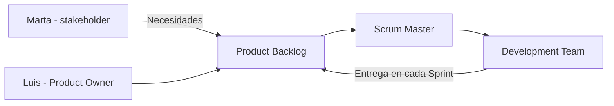
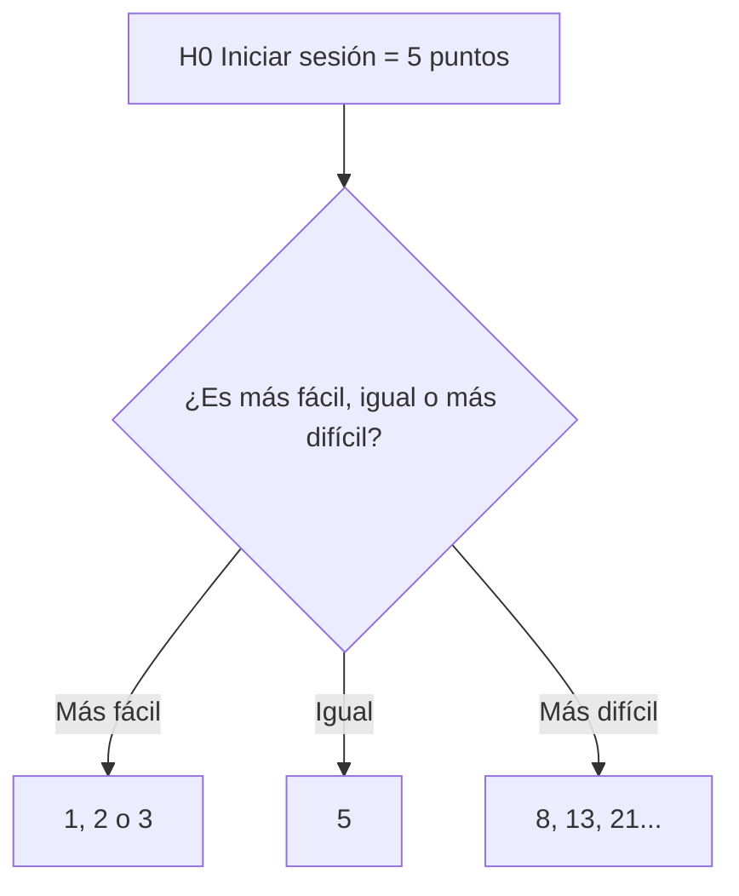
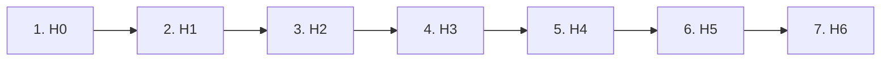

# Ejercicio 5 - Product Backlog con Scrum

Plataforma "EduPro" de Tech4Learning. Con lo que piden Marta (profesora) y Luis (director) hay que hacer los roles, las historias de usuario, los criterios de aceptación, estimar con Planning Poker y ordenar el Product Backlog.

## 1. Roles

| Rol | Quién | Por qué |
|---|---|---|
| **Product Owner** | Luis | Es el director del centro que va a usar la plataforma y puede decidir qué es más importante |
| **Scrum Master** | Alguien de Tech4Learning (no dice el nombre) | Ayuda al equipo a seguir Scrum |
| **Development Team** | El equipo de Tech4Learning | Son los que programan la plataforma |
| **Stakeholder** | Marta | Va a usar la plataforma y dice lo que necesita, pero no decide el orden |

## 2. Historias de usuario

**Lo que pide Marta:**

**H1.** Como **profesor**, quiero **subir material en PDF, vídeo o enlace**, para **que mis alumnos lo puedan ver**.

**H2.** Como **alumno**, quiero **ver el material desde cualquier dispositivo**, para **poder estudiar desde el ordenador o desde el móvil**.

**H3.** Como **profesor**, quiero **ordenar el material por temas o semanas**, para **que los alumnos encuentren las cosas más fácil**.

**Lo que pide Luis:**

**H4.** Como **profesor**, quiero **programar exámenes online con preguntas tipo test y preguntas abiertas**, para **hacer exámenes sin papel**.

**H5.** Como **profesor**, quiero **que las preguntas tipo test se corrijan solas**, para **ahorrar tiempo corrigiendo**.

**H6.** Como **alumno**, quiero **que me llegue una notificación cuando se publica una actividad nueva**, para **no tener que estar mirando la plataforma todo el rato**.

**Historia de referencia:**

**H0.** Como **usuario**, quiero **iniciar sesión con correo y contraseña**, para **entrar a mi cuenta** - **5 puntos**.

## 3. Criterios de aceptación

### H1 - Subir material

- **Dado** que el profesor elige un PDF de menos de 20 MB, **cuando** pulsa "Subir", **entonces** el PDF aparece en su asignatura.
- **Dado** que el profesor pone un enlace a un vídeo de YouTube, **cuando** pulsa "Añadir enlace", **entonces** el enlace sale junto al resto del material.
- **Dado** que el profesor intenta subir un archivo que no se permite, **cuando** pulsa "Subir", **entonces** sale un aviso con los formatos que sí se pueden subir y no se sube.

### H2 - Ver desde cualquier dispositivo

- **Dado** que un alumno ha entrado desde el ordenador, **cuando** va a materiales, **entonces** lo ve todo bien.
- **Dado** que un alumno ha entrado desde el móvil, **cuando** va a materiales, **entonces** la página se adapta a la pantalla y se puede usar bien.

### H3 - Ordenar por temas o semanas

- **Dado** que el profesor ha creado el "Tema 3", **cuando** sube un material nuevo, **entonces** puede meterlo en ese tema.
- **Dado** que un alumno entra en materiales, **cuando** mira la lista, **entonces** ve el material separado por temas o semanas y no todo mezclado.

### H4 - Programar examen

- **Dado** que el profesor está haciendo un examen, **cuando** añade una pregunta tipo test, **entonces** se guarda con la respuesta correcta marcada.
- **Dado** que el profesor está haciendo un examen, **cuando** añade una pregunta abierta, **entonces** se guarda sin respuesta correcta.
- **Dado** que el examen tiene preguntas y una fecha, **cuando** el profesor lo programa, **entonces** los alumnos lo pueden ver a partir de esa fecha.

### H5 - Corrección automática

- **Dado** que un alumno ha contestado las preguntas tipo test, **cuando** entrega el examen, **entonces** sale la nota de esas preguntas automáticamente.
- **Dado** que el examen tiene preguntas tipo test y abiertas, **cuando** se corrige, **entonces** solo se corrigen solas las de tipo test y las abiertas las corrige el profesor.

### H6 - Notificaciones

- **Dado** que un profesor publica una actividad nueva, **cuando** se publica, **entonces** les llega una notificación a todos los alumnos de esa asignatura.
- **Dado** que un alumno tiene las notificaciones quitadas, **cuando** se publica una actividad, **entonces** no le llega nada.

## 4. Planning Poker

Usamos de referencia **H0 - Iniciar sesión = 5 puntos**. Cada historia se compara con esta para ver si es más fácil, igual o más difícil.

| Historia | Puntos | Por qué |
|---|---|---|
| H1 - Subir material | 8 | Más difícil que el login porque hay varios tipos de archivo y hay que guardarlos y comprobarlos |
| H2 - Cualquier dispositivo | 5 | Parecido al login, es sobre todo hacer la página responsive |
| H3 - Ordenar por temas | 3 | Más fácil, solo es ponerle un tema o semana al material que ya existe |
| H4 - Programar examen | 13 | Mucho más difícil, hay dos tipos de preguntas y además hay que programar la fecha |
| H5 - Corrección automática | 8 | Más difícil que el login, hay que comparar respuestas y sacar la nota, aunque usa lo de H4 |
| H6 - Notificaciones | 5 | Parecido al login, es avisar a los alumnos cuando se publica algo |

## 5. Product Backlog

Lo he ordenado por lo que es más importante para el centro (lo que dice Luis, que es el Product Owner) y por las historias que dependen de otras. Por ejemplo, H5 no se puede hacer sin H4.

| Orden | Historia | Puntos | Por qué va aquí |
|---|---|---|---|
| 1 | H0 - Iniciar sesión | 5 | Sin login no se puede usar nada |
| 2 | H1 - Subir material | 8 | Sin material la plataforma no sirve, es lo primero que pide Marta |
| 3 | H2 - Cualquier dispositivo | 5 | Para que los alumnos puedan ver el material que se sube |
| 4 | H3 - Ordenar por temas | 3 | Mejora H1 pero no es imprescindible |
| 5 | H4 - Programar examen | 13 | Luis dice que es fundamental, aunque es la más larga |
| 6 | H5 - Corrección automática | 8 | Necesita que H4 esté hecha |
| 7 | H6 - Notificaciones | 5 | Está bien tenerlo pero la plataforma funciona sin esto |

