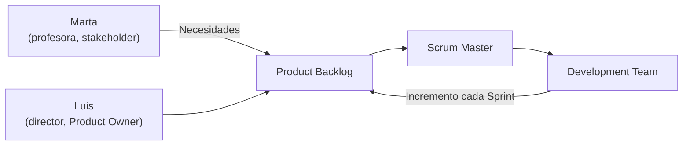
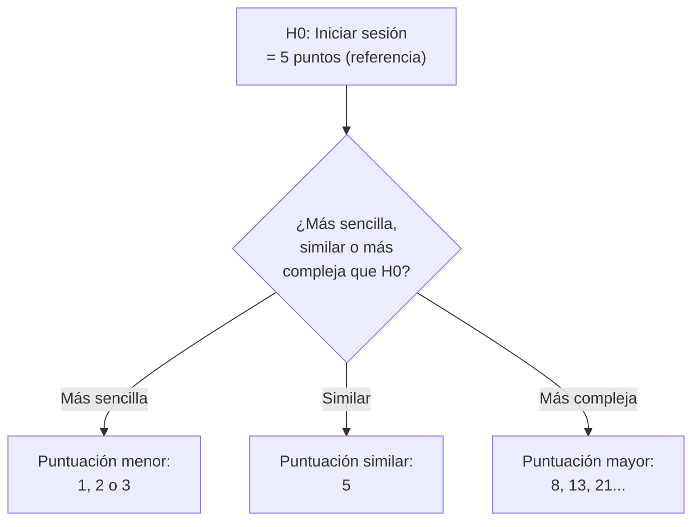
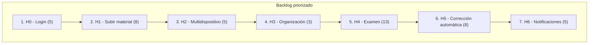

# Solución Ejercicio 5 — Product Backlog con Scrum

## Enunciado

Plataforma educativa "EduPro" (Tech4Learning). A partir de las necesidades planteadas por Marta (profesora) y Luis (director de centro), construir el Product Backlog siguiendo Scrum: roles, historias de usuario, criterios de aceptación y estimación con Planning Poker.

---

## 1. Roles

| Rol Scrum | Quién lo representa | Motivo |
|---|---|---|
| **Product Owner** | Luis (director de centro) | Representa a los centros que usarán la plataforma y decide qué aporta más valor de negocio |
| **Scrum Master** | Un miembro del equipo de Tech4Learning (no mencionado por nombre) | Facilita el proceso Scrum del equipo de desarrollo |
| **Development Team** | El equipo de desarrollo de Tech4Learning | Construye la plataforma |
| **Stakeholder (no forma parte del equipo Scrum)** | Marta (profesora) | Aporta necesidades como usuaria final, pero no toma las decisiones de priorización |

---

## 2. Historias de usuario

A partir de las dos intervenciones se identifican dos bloques de necesidades: **gestión de contenidos** (Marta) y **exámenes y notificaciones** (Luis).

### Bloque A — Material didáctico (a partir de la intervención de Marta)

**H1.** Como **profesor**, quiero **subir material didáctico en formato PDF, vídeo o enlace**, para **ponerlo a disposición de mis alumnos**.

**H2.** Como **alumno**, quiero **acceder al material didáctico desde cualquier dispositivo**, para **poder estudiar tanto desde el ordenador como desde el móvil**.

**H3.** Como **profesor**, quiero **organizar el material por temas o semanas**, para **que los alumnos encuentren fácilmente el contenido correspondiente a cada momento del curso**.

### Bloque B — Exámenes y notificaciones (a partir de la intervención de Luis)

**H4.** Como **profesor**, quiero **programar un examen online con preguntas de opción múltiple y preguntas abiertas**, para **evaluar a mis alumnos sin necesidad de papel**.

**H5.** Como **profesor**, quiero **que las preguntas de opción múltiple se corrijan automáticamente**, para **ahorrar tiempo de corrección**.

**H6.** Como **alumno**, quiero **recibir una notificación cuando se publica una nueva actividad**, para **enterarme sin tener que revisar la plataforma constantemente**.

### Historia de referencia (ya estimada)

**H0.** Como **usuario de la plataforma**, quiero **iniciar sesión con correo electrónico y contraseña**, para **acceder a mi contenido personal** — **5 puntos** (estimación ya realizada por el equipo).

---

## 3. Criterios de aceptación (mínimo 2 por historia)

### H1 — Subir material didáctico

- **Dado** que el profesor ha seleccionado un archivo PDF de menos de 20 MB, **cuando** pulsa "Subir material", **entonces** el archivo queda disponible en la plataforma asociado a su asignatura.
- **Dado** que el profesor introduce un enlace externo (por ejemplo, a un vídeo de YouTube), **cuando** pulsa "Añadir enlace", **entonces** el enlace queda visible junto al resto del material.
- **Dado** que el profesor intenta subir un archivo de un formato no soportado, **cuando** pulsa "Subir material", **entonces** el sistema muestra un aviso indicando los formatos permitidos y no se sube el archivo.

### H2 — Acceso desde cualquier dispositivo

- **Dado** que un alumno ha iniciado sesión desde un ordenador, **cuando** accede al apartado de materiales, **entonces** puede visualizar el contenido correctamente.
- **Dado** que un alumno ha iniciado sesión desde un teléfono móvil, **cuando** accede al mismo apartado, **entonces** el contenido se adapta al tamaño de pantalla y sigue siendo accesible.

### H3 — Organización por temas o semanas

- **Dado** que un profesor ha creado el "Tema 3" en su asignatura, **cuando** sube un nuevo material, **entonces** puede asignarlo a ese tema y el material aparece agrupado bajo él.
- **Dado** que un alumno entra en el apartado de materiales, **cuando** consulta el listado, **entonces** ve los materiales agrupados por tema o semana en lugar de en una lista única desordenada.

### H4 — Programar examen con preguntas de opción múltiple y abiertas

- **Dado** que un profesor está creando un examen, **cuando** añade una pregunta de tipo "opción múltiple" con varias respuestas, **entonces** el sistema la guarda marcando cuál es la respuesta correcta.
- **Dado** que un profesor está creando un examen, **cuando** añade una pregunta de tipo "abierta", **entonces** el sistema la guarda sin necesidad de marcar una respuesta correcta.
- **Dado** que el examen tiene al menos una pregunta y una fecha de publicación, **cuando** el profesor lo programa, **entonces** el examen queda visible para los alumnos a partir de esa fecha.

### H5 — Corrección automática de opción múltiple

- **Dado** que un alumno ha respondido todas las preguntas de opción múltiple de un examen, **cuando** entrega el examen, **entonces** el sistema calcula automáticamente la nota de esas preguntas.
- **Dado** que un examen combina preguntas de opción múltiple y preguntas abiertas, **cuando** se corrige automáticamente, **entonces** solo se calcula la nota de las preguntas de opción múltiple y las abiertas quedan pendientes de corrección manual por el profesor.

### H6 — Notificaciones de nuevas actividades

- **Dado** que un profesor publica una nueva actividad, **cuando** la publicación se confirma, **entonces** todos los alumnos matriculados en esa asignatura reciben una notificación.
- **Dado** que un alumno tiene las notificaciones desactivadas, **cuando** se publica una nueva actividad, **entonces** no recibe la notificación (se respeta su configuración).

---

## 4. Estimación con Planning Poker

**Historia de referencia:** H0 — Iniciar sesión con correo y contraseña = **5 puntos.**

Se usa H0 como vara de medir: cada nueva historia se compara con ella en términos de complejidad técnica, no de tiempo.

| Historia | Estimación | Justificación frente a H0 (5 pts) |
|---|---|---|
| **H1** — Subir material (PDF, vídeo, enlace) | **8** | Más compleja que iniciar sesión: hay que gestionar la subida y el almacenamiento de varios tipos de archivo, con validaciones distintas para cada uno. |
| **H2** — Acceso desde cualquier dispositivo | **5** | Complejidad similar a H0: es principalmente una cuestión de adaptar la interfaz (diseño responsive), sin lógica de negocio compleja añadida. |
| **H3** — Organizar material por temas/semanas | **3** | Más sencilla que H0: consiste en añadir una agrupación/etiqueta al material ya existente, sin nueva lógica de validación relevante. |
| **H4** — Programar examen (opción múltiple y abiertas) | **13** | Notablemente más compleja que H0: requiere modelar dos tipos de pregunta distintos, gestionar su programación en el tiempo y su visibilidad. |
| **H5** — Corrección automática de opción múltiple | **8** | Más compleja que H0: implica comparar respuestas del alumno con las correctas y calcular una nota, aunque se apoya en H4 ya existente. |
| **H6** — Notificaciones de nueva actividad | **5** | Similar a H0 en complejidad: es un mecanismo de aviso relativamente autocontenido, comparable en esfuerzo a la gestión de sesión. |

---

## 5. Product Backlog priorizado

**Criterio de priorización elegido:** valor de negocio para los centros (Luis, como Product Owner) combinado con las dependencias técnicas entre historias — por ejemplo, H5 (corrección automática) depende de que exista H4 (creación de exámenes).

| Orden | Historia | Puntos | Motivo de la prioridad |
|---|---|---|---|
| 1 | H0 — Iniciar sesión | 5 | Ya implementada/estimada; es la base de acceso a toda la plataforma |
| 2 | H1 — Subir material didáctico | 8 | Sin contenido no hay plataforma útil; es la funcionalidad más solicitada por Marta |
| 3 | H2 — Acceso desde cualquier dispositivo | 5 | Condiciona cómo se consume el material recién subido (H1) |
| 4 | H3 — Organizar material por temas/semanas | 3 | Mejora sobre H1; aporta valor pero no bloquea el uso básico |
| 5 | H4 — Programar examen | 13 | Alto valor de negocio (Luis lo señala como "fundamental"), aunque es la historia más compleja |
| 6 | H5 — Corrección automática | 8 | Depende directamente de H4; no tiene sentido antes de que existan exámenes |
| 7 | H6 — Notificaciones de nueva actividad | 5 | Mejora la experiencia, pero la plataforma funciona sin ella; se deja para el final |

