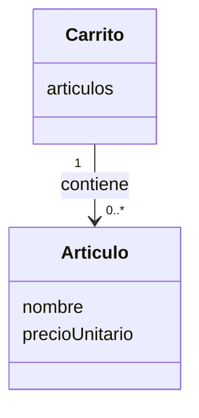

# Ejercicio 2 - Simulación de iteración ágil (Carrito de la compra)

## Iteración 1 - Funcionalidades básicas

### Tarjeta CRC: `Artículo`

| Clase: Artículo | |
|---|---|
| **Responsabilidades** | **Colaboradores** |
| Conocer su nombre | — |
| Conocer su precio unitario | — |

### Tarjeta CRC: `Carrito`

| Clase: Carrito | |
|---|---|
| **Responsabilidades** | **Colaboradores** |
| Añadir un artículo | `Artículo` |
| Calcular el total | `Artículo` |
| Conocer cuántos artículos contiene | — |

### Relación entre las clases

### Casos de prueba de la iteración 1

1. **Carrito vacío:** si se crea un carrito y no se añade nada, el total tiene que ser 0 y el número de artículos también 0.
2. **Añadir dos artículos:** si se añade un artículo de 10 € y otro de 5,50 €, el total tiene que ser 15,50 € y el carrito tiene que tener 2 artículos.
3. **Añadir un artículo:** si se añade un solo artículo de 3 €, el total es 3 € y el carrito tiene 1 artículo.

---

## Iteración 2 - Cambios tras la revisión con el cliente

El cliente pide dos cosas nuevas: poder eliminar un artículo por su nombre y poder calcular el total con un descuento en porcentaje. La clase `Artículo` no cambia; los cambios van en `Carrito`.

### Tarjeta CRC: `Artículo` (sin cambios)

| Clase: Artículo | |
|---|---|
| **Responsabilidades** | **Colaboradores** |
| Conocer su nombre | — |
| Conocer su precio unitario | — |

### Tarjeta CRC: `Carrito` (actualizada)

| Clase: Carrito | |
|---|---|
| **Responsabilidades** | **Colaboradores** |
| Añadir un artículo | `Artículo` |
| Calcular el total | `Artículo` |
| Conocer cuántos artículos contiene | — |
| Eliminar un artículo por nombre *(nueva)* | `Artículo` |
| Calcular el total con un descuento en porcentaje *(nueva)* | `Artículo` |

### Casos de prueba de la iteración 2

Los casos de la iteración 1 se tienen que seguir cumpliendo. Además:

**Eliminar por nombre**

4. **Eliminar un artículo que está:** con "Pan" (1 €) y "Leche" (2 €) en el carrito, al eliminar "Pan" queda 1 artículo y el total es 2 €.
5. **Eliminar un artículo que no está:** si se intenta eliminar "Huevos" y no está en el carrito, el carrito se queda igual (mismos artículos y mismo total).
6. **Eliminar en un carrito vacío:** no da error y el carrito sigue vacío con total 0.

**Total con descuento**

7. **Descuento normal:** con artículos que suman 100 €, el total con un 10 % de descuento es 90 €.
8. **Descuento del 0 %:** el total con descuento es igual que el total normal.
9. **Descuento del 100 %:** el total con descuento es 0 €.
10. **Descuento en carrito vacío:** el total con cualquier descuento es 0 €.
11. **Descuento no válido:** si el porcentaje es menor que 0 o mayor que 100, no se aplica y se avisa del error.
12. **El descuento no cambia el carrito:** después de calcular el total con descuento, el total normal sigue siendo el mismo (el descuento no borra ni cambia los precios de los artículos).
